# QR Studio

[](https://github.com/ALPHAMAN-0/QR_Code/actions/workflows/deploy.yml)
[](LICENSE)


Make and scan QR codes and **111 barcode formats** in your browser, on any device. Works offline and installs like an app. Nothing you make or scan ever leaves your device.

**Open it:** https://alphaman-0.github.io/QR_Code/

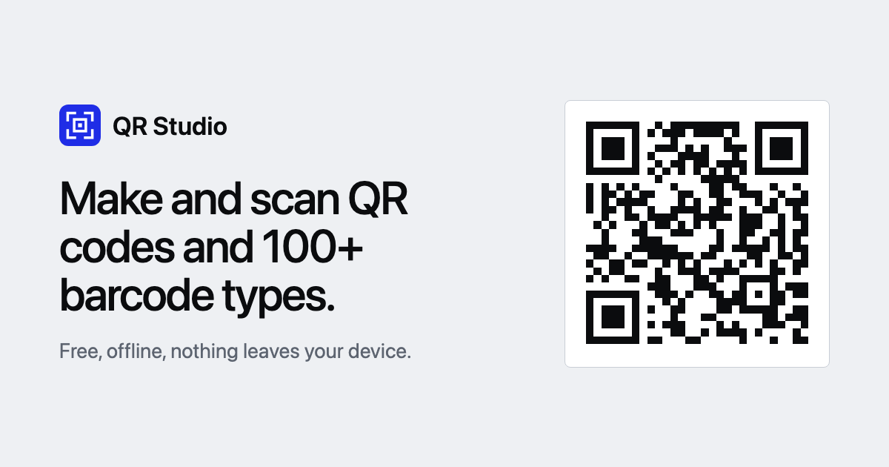

## Contents

- [At a glance](#at-a-glance)
- [Features](#features)
- [Supported formats](#supported-formats)
- [How it works](#how-it-works)
  - [Architecture](#architecture)
  - [Making a code](#making-a-code)
  - [The self-check](#the-self-check)
  - [Scanning a code](#scanning-a-code)
  - [Offline and updates](#offline-and-updates)
- [Install it as an app](#install-it-as-an-app)
- [Privacy and security](#privacy-and-security)
- [Development](#development)
- [Credits](#credits)
- [License](#license)

## At a glance

QR Studio is a static web app. GitHub Pages only hands out its files. Everything else (drawing codes, reading them, saving history) happens inside your browser.

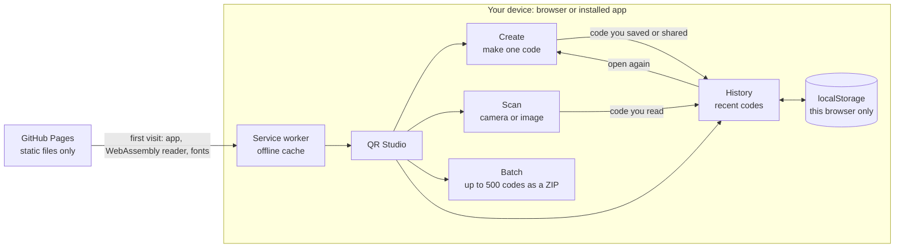

The app has four sections. Each one has its own address, so you can bookmark or share it:

| Section | Address | What it is for |
|---|---|---|
| **Create** | [`#create`](https://alphaman-0.github.io/QR_Code/#create) | Make one code, style it, check it scans, then download, copy, share or print it |
| **Scan** | [`#scan`](https://alphaman-0.github.io/QR_Code/#scan) | Read codes from the camera, a file, drag and drop, or a pasted screenshot |
| **Batch** | [`#batch`](https://alphaman-0.github.io/QR_Code/#batch) | Turn a list of up to 500 values into a ZIP of PNG or SVG files |
| **History** | [`#history`](https://alphaman-0.github.io/QR_Code/#history) | See recent codes and open one again in Create |

## Features

### Create
- **Every common code**, including QR Code, Micro QR, rMQR, Data Matrix, Aztec, PDF417, MaxiCode, Han Xin, DotCode, EAN-13/8, UPC-A/E, ISBN, Code 128, Code 39, Code 93, ITF-14, Codabar and GS1-128.
- **GS1 DataBar** and composites.
- **Postal codes:** USPS Intelligent Mail, Royal Mail, Australia Post, Japan Post and KIX.
- **Healthcare codes:** HIBC, PZN and Pharmacode.
- **111 formats** in total, drawn with [bwip-js](https://github.com/metafloor/bwip-js). See [Supported formats](#supported-formats).
- **Ready-made QR content** that phone cameras understand: links, text, Wi-Fi logins, contact cards (vCard), email, phone calls, SMS, map locations and calendar events.
- **Style:** colors, transparent background, size up to print resolution, quiet zone, error correction (L/M/Q/H) and a logo in the middle.
- **Color warnings:** low contrast, light-on-dark codes, and light bars on a transparent background are flagged before you print.
- **Self-check:** every code is read back by the built-in scanner, so you know it works before you print it. See [The self-check](#the-self-check).
- **Output:** download PNG or SVG, copy the image, share it or print it.

### Scan
- **Live camera** (front or back), **image upload**, **drag and drop**, or **paste a screenshot**.
- Reads QR, Micro QR, rMQR, Data Matrix, Aztec, PDF417, MaxiCode, EAN/UPC, Code 128/39/93, ITF, Codabar, GS1 DataBar and Telepen, using [zxing-wasm](https://github.com/Sec-ant/zxing-wasm).
- Finds **up to 8 codes in one picture**, including rotated and inverted (light-on-dark) ones.
- **Smart actions:** open a link (showing its real destination and warning about tricks), copy a Wi-Fi password, save a contact (.vcf), add an event (.ics), call, text, email or open a map.

### Batch
- Paste up to **500 values**, one per line, pick a format and get a **ZIP of PNG or SVG files**.
- Lines that can't be encoded are listed with their line number; the rest still download.

### History
- Recent codes (the newest 100) are kept **only in this browser**.
- Switch history off (this also clears it) or clear it at any time.
- Wi-Fi passwords are never saved.

## Supported formats

All 111 formats can be **made**. 54 of them can also be **scanned**, both from the Scan screen and by the self-check in Create.

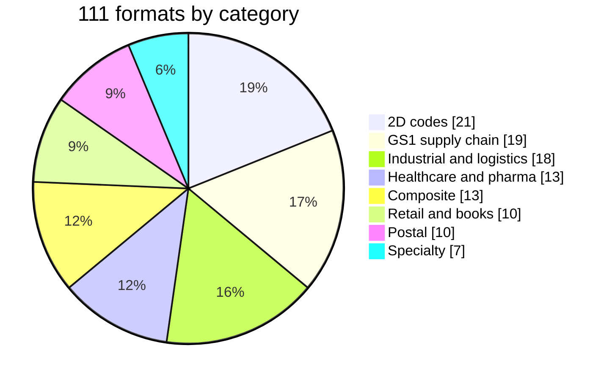

| Category | Make | Scan | Examples |
|---|---:|---:|---|
| 2D codes | 21 | 13 | QR Code, Micro QR, rMQR, Swiss QR, Data Matrix, Aztec, PDF417, MaxiCode, Han Xin, DotCode, Code One |
| GS1 supply chain | 19 | 16 | GS1-128, EAN-14, SSCC-18, ITF-14, GS1 DataBar (all 7 kinds), GS1 QR, GS1 Data Matrix, GS1 Digital Link |
| Industrial and logistics | 18 | 9 | Code 128, Code 39, Code 93, Interleaved 2 of 5, Codabar, Telepen, Code 11, MSI Plessey |
| Healthcare and pharma | 13 | 10 | HIBC (Code 39, Code 128, Data Matrix, PDF417, QR, Aztec), PZN, Italian Pharmacode, Pharmacode |
| Composite | 13 | 0 | EAN-13, EAN-8, UPC-A, UPC-E, GS1 DataBar and GS1-128 composites |
| Retail and books | 10 | 6 | EAN-13, EAN-8, UPC-A, UPC-E, ISBN, ISMN, ISSN, EAN-2/EAN-5 add-ons |
| Postal | 10 | 0 | USPS Intelligent Mail, POSTNET, PLANET, Royal Mail, Mailmark, Australia Post, Japan Post, KIX |
| Specialty | 7 | 0 | BC412, PosiCode, Channel Code, Flattermarken, custom 1D and 4-state |

The scanner list comes from `DECODER_FORMATS` in [`src/lib/symbologies.ts`](src/lib/symbologies.ts). Formats outside it are still drawn to the official specification; the app just can't double-check them.

## How it works

### Architecture

The code is split into three layers. The screens hold state and layout, `src/lib/` holds plain TypeScript logic with its own tests, and three bundled libraries do the heavy lifting.

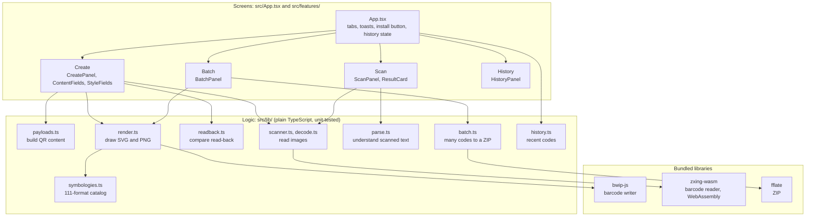

Two helpers are shared by several screens and left out of the picture to keep it readable: `files.ts` (download, copy, share, print, logo import) and `contrast.ts` (color warnings).

| Module | Job |
|---|---|
| [`payloads.ts`](src/lib/payloads.ts) | Builds QR content: links, Wi-Fi, vCard, email, phone, SMS, map location, calendar event. Validates input and escapes special characters. |
| [`symbologies.ts`](src/lib/symbologies.ts) | The catalog of 111 formats: name, category, sample value, default options, and which ones the scanner can read. |
| [`render.ts`](src/lib/render.ts) | Draws SVG, canvas and PNG with bwip-js. Applies colors, size, quiet zone, error correction and the logo. |
| [`scanner.ts`](src/lib/scanner.ts) | Browser entry for the reader. Points zxing-wasm at the bundled `.wasm` file and prepares pixels (flattens transparency onto white, scales down). |
| [`decode.ts`](src/lib/decode.ts) | Runs zxing-wasm on an image and returns format, text and corner positions. |
| [`readback.ts`](src/lib/readback.ts) | The self-check: compares what you typed with what the reader found, allowing for check digits and format quirks. |
| [`parse.ts`](src/lib/parse.ts) | Turns scanned text into a link, Wi-Fi login, contact, event and so on, and checks links for tricks. |
| [`contrast.ts`](src/lib/contrast.ts) | Contrast ratio and color warnings. |
| [`history.ts`](src/lib/history.ts) | Reads and writes recent codes in `localStorage`, removes Wi-Fi passwords, keeps the newest 100. |
| [`batch.ts`](src/lib/batch.ts) | Splits lines, names files, renders each value and builds the ZIP. |
| [`files.ts`](src/lib/files.ts) | Download, copy, share and print, plus re-encoding uploaded logos as PNG. |

### Making a code

The preview redraws as you type. Free-text formats such as QR Code and Data Matrix get a content form (link, Wi-Fi, contact and so on). Other barcodes take the value directly.

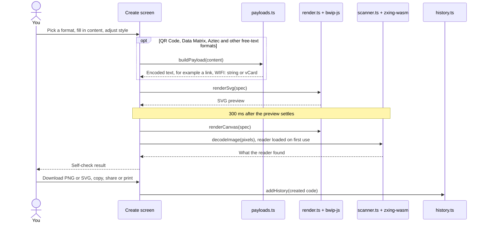

### The self-check

After drawing a code, Create scans its own output with the same reader the Scan screen uses. You see one of four results:

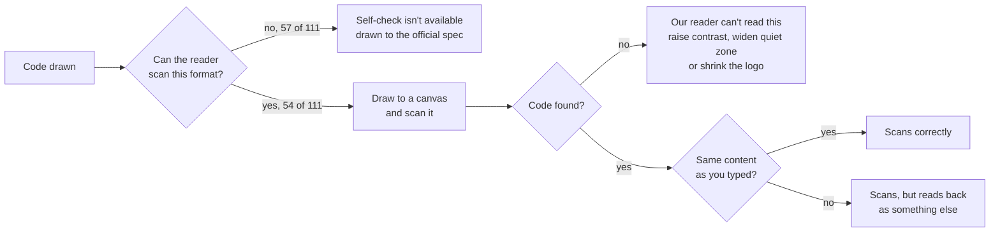

"Same content" allows for things scanners legitimately change: added check digits, dropped add-ons, GS1 formatting, a UPC-E code read back as UPC-A, or Code 39 switching to Full ASCII.

### Scanning a code

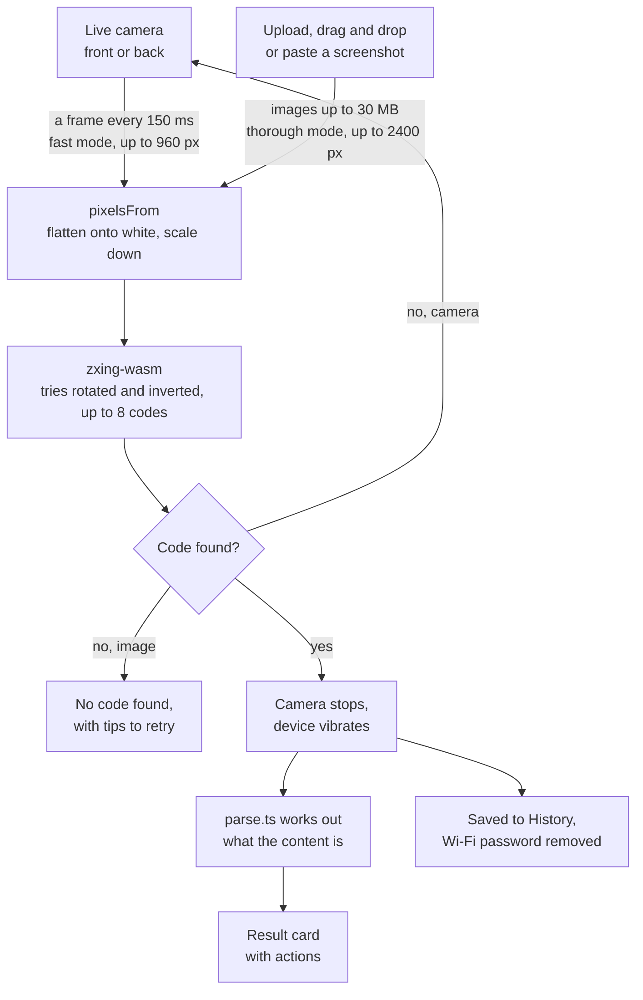

The camera is also released when you switch sections or the page is hidden. Every result card has **Copy** and a **Raw data** view, plus an action that fits the content:

| Scanned content | Recognized by | Action |
|---|---|---|
| Link | `http://`, `https://`, `www.` | **Open link**, with the real host shown and any [warnings](#scanned-content-is-untrusted) |
| Wi-Fi | `WIFI:` | **Show password** (hidden by default), **Copy password** |
| Contact | `BEGIN:VCARD`, `MECARD:` | **Save contact** as `.vcf` |
| Email | `mailto:`, `MATMSG:` | **Write email** |
| Phone | `tel:` | **Call** |
| SMS | `sms:`, `SMSTO:` | **Send text** |
| Location | `geo:` | **Open map** on OpenStreetMap |
| Event | `BEGIN:VEVENT`, `BEGIN:VCALENDAR` | **Add to calendar** as `.ics` |
| Anything else | | Shown as plain text |

### Offline and updates

QR Studio is a Progressive Web App. On the first visit a service worker stores every file the app needs, including the WebAssembly reader and the fonts. After that it opens without internet.

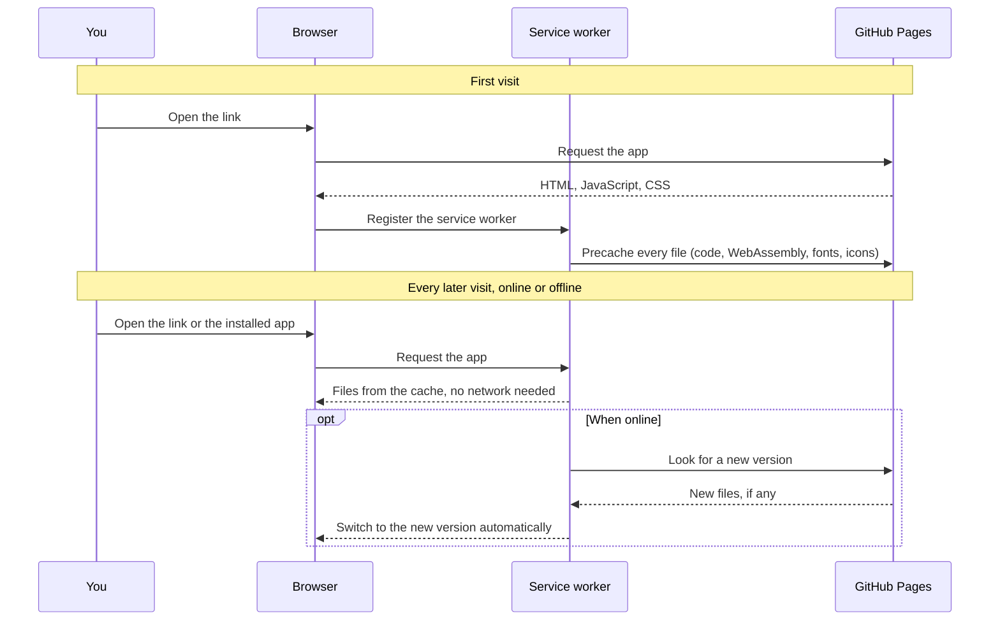

## Install it as an app

| Device | How |
|---|---|
| Android (Chrome) | Open the link, then tap **Install app** (or ⋮ → *Install app*) |
| iPhone / iPad (Safari) | Open the link, tap **Share** → **Add to Home Screen** |
| Windows, macOS, Linux (Chrome / Edge) | Click **Install app** in the top bar, or the install icon in the address bar |

After the first visit it works **without internet**.

## Privacy and security

- No server, no accounts, no analytics. All generation and decoding happen on your device.
- The barcode reader's WebAssembly and the fonts are bundled with the app. It never contacts a CDN.
- A strict Content Security Policy is applied to the production build: `default-src 'self'`, no inline scripts, `form-action 'none'`, `object-src 'none'`. The only extra permission is `'wasm-unsafe-eval'`, which the WebAssembly reader needs to start.
- Uploaded logos are re-encoded as plain PNG before use.

### Scanned content is untrusted

A code can hold anything, so scanned text is never trusted:

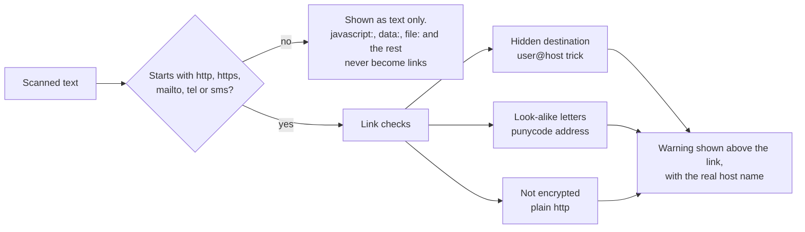

- Only `http(s)`, `mailto`, `tel` and `sms` ever become links.
- When a link hides its destination or uses look-alike letters, the **Open link** button is toned down so it is not the obvious thing to tap.
- Contact and calendar files are rebuilt from checked fields, not saved as the raw scanned text.
- Wi-Fi passwords are hidden on screen until you choose **Show password**.

### What History stores

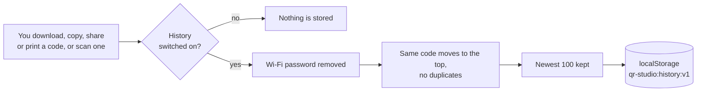

Switching History off also deletes what was stored.

## Development

Requires Node.js 20.19+ (22 recommended).

```bash
npm ci --ignore-scripts    # install exact, locked versions without running install scripts
npm run dev                # http://localhost:5173/QR_Code/
npm test                   # unit + component tests (Vitest)
npm run coverage           # tests with coverage report (80% thresholds)
npm run lint               # ESLint incl. react-hooks and jsx-a11y
npm run typecheck          # TypeScript
npm run build              # production build in dist/
npx playwright install chromium && npm run e2e   # browser tests on the production build
```

### Tech stack

| Part | Choice |
|---|---|
| UI | React 19, TypeScript 6 |
| Build | Vite 8, `vite-plugin-pwa` (Workbox precache, auto-update) |
| Barcode writer | bwip-js 4 (Barcode Writer in Pure PostScript) |
| Barcode reader | zxing-wasm 3 (ZXing-C++ compiled to WebAssembly) |
| ZIP | fflate |
| Tests | Vitest, Testing Library, jsdom, Playwright, axe-core |
| Hosting | GitHub Pages, deployed by GitHub Actions |

### Project layout

```text
QR_Code/
├── index.html                 # app shell
├── vite.config.ts             # build, PWA manifest and service worker, CSP, test settings
├── playwright.config.ts       # end-to-end tests: production build, desktop and Pixel 7
├── public/                    # app icons and the social preview image
├── scripts/make-icons.mjs     # regenerates the icons and preview image from favicon.svg
├── src/
│   ├── main.tsx               # entry point
│   ├── App.tsx                # tabs, toasts, install button, history state
│   ├── components/            # ErrorBoundary, Icon
│   ├── features/
│   │   ├── create/            # CreatePanel, ContentFields, StyleFields
│   │   ├── scan/              # ScanPanel, ResultCard
│   │   ├── batch/             # BatchPanel
│   │   └── history/           # HistoryPanel
│   ├── lib/                   # plain logic, next to its *.test.ts files
│   └── test/                  # test setup, DOM helpers, WebAssembly loader for Node
├── e2e/                       # Playwright tests
└── .github/
    ├── workflows/deploy.yml   # CI and GitHub Pages deploy
    └── dependabot.yml         # dependency update PRs
```

### Tests

| Layer | Tools | What it covers |
|---|---|---|
| Unit | Vitest | Everything in `src/lib/`. The real WebAssembly reader runs in Node, so codes are drawn and read back for real. |
| Component | Vitest, Testing Library, jsdom | The app shell, Create, Scan, Batch and the result card. |
| End-to-end | Playwright, axe-core | The production build in Chromium on a desktop and a Pixel 7 viewport: a downloaded PNG scans back to the same link, every quick format passes the self-check, a QR code with a logo still scans, batch ZIP download, a fake webcam feed, Wi-Fi password hiding, WCAG 2.2 AA checks, 320 px layouts, offline mode, no third-party requests and no CSP violations. |

Coverage must stay at 80% or more for lines, functions and statements, and 75% for branches.

### CI and deployment

Every push and pull request runs the full pipeline in [`.github/workflows/deploy.yml`](.github/workflows/deploy.yml). Only `main` is deployed. Actions are pinned to full commit SHAs.

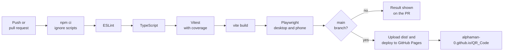

## Credits
- [bwip-js](https://github.com/metafloor/bwip-js) (MIT): barcode generation (Barcode Writer in Pure PostScript).
- [zxing-wasm](https://github.com/Sec-ant/zxing-wasm) (MIT), built on [ZXing-C++](https://github.com/zxing-cpp/zxing-cpp) (Apache-2.0): barcode reading.
- [fflate](https://github.com/101arrowz/fflate) (MIT): ZIP files.
- Fonts: [Epilogue](https://fonts.google.com/specimen/Epilogue) and [JetBrains Mono](https://www.jetbrains.com/lp/mono/) (SIL Open Font License), self-hosted.

## License
[MIT](LICENSE)
